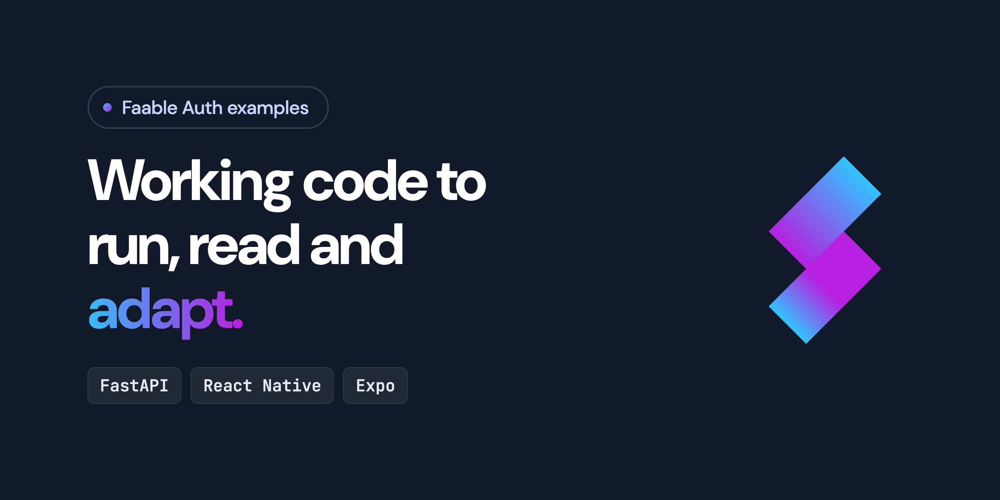

  

# Faable Auth examples

Small, runnable projects that show how to add [Faable Auth](https://faable.com/docs/auth) to your
stack: sign users in from an app, then verify their access tokens in your API.

| Example                                  | Stack                   | What it shows                                                                |
| ---------------------------------------- | ----------------------- | ---------------------------------------------------------------------------- |
| [`fastapi`](./fastapi)                   | Python, FastAPI, PyJWT  | An API that verifies Faable Auth access tokens against your tenant's JWKS    |
| [`react-native-expo`](./react-native-expo) | React Native, Expo    | Social login in a mobile app with [`@faable/auth-js`](https://github.com/faablecloud/auth-js) |

## Before you start

You need a Faable account and an Auth tenant. Create both in the
[dashboard](https://dashboard.faable.com), or follow the
[getting started guide](https://faable.com/docs/auth/get-started). Each example's README lists the
values it needs from your tenant.

Looking for your framework? The [quickstarts](https://faable.com/docs/auth/quickstart) cover
JavaScript, React, Next.js, Vue, Nuxt, Angular, SvelteKit, FastAPI and React Native.

## Documentation

- [Faable Auth documentation](https://faable.com/docs/auth)
- [Validate access tokens](https://faable.com/docs/auth/validate-access-tokens)
- [OAuth 2.0 flows](https://faable.com/docs/auth/oauth-flows)
- [OpenID Connect](https://faable.com/docs/auth/oidc)

## Support

- **Questions about Faable:** [support@faable.com](mailto:support@faable.com) or the
  [support page](https://faable.com/docs/platform/support)
- **Bugs in an example:** [open an issue](https://github.com/faablecloud/faableauth-examples/issues)
- **Security issues:** report them privately to [support@faable.com](mailto:support@faable.com),
  not in a public issue

## License

[MIT](LICENSE) © Faable Cloud SLU
